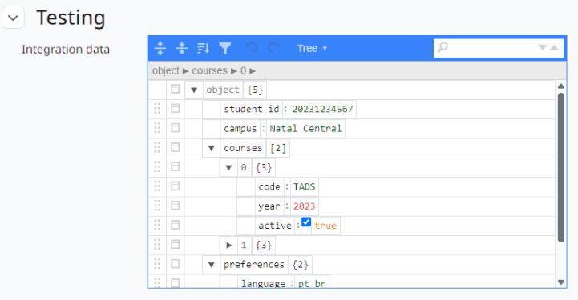

moodle-profilefield_json
========================

**A user profile field that stores a JSON document, edited with a visual tree editor and always valid.**

   Editing a profile: the JSON field opens a tree editor.

* **Structured data in the profile.** Keep integration identifiers, preferences or any nested data in one field instead of many text fields.
* **Visual editor.** Tree, form and text modes from `JSON Editor <https://github.com/josdejong/jsoneditor>`_, with the plain textarea as a fallback.
* **Always valid.** The server only saves valid JSON within the size limit set for the field, and stores it in a canonical, pretty-printed form.
* **Safe to display.** The document is shown escaped in a code block; HTML inside strings is never rendered.

Versão em português: `Português (Brasil) <../pt-br/index.html>`_.

.. toctree::
   :maxdepth: 2
   :caption: Contents

   installation
   configuration
   usage

Main features
-------------

* New profile field type **JSON**, created at *Site administration > Users > Accounts > User profile fields*.
* Maximum size per field (64 KB by default, up to 1024 KB) and a validated default value.
* Validation on the profile and signup forms, with the parser error shown to the user; invalid values from the user upload or web services are ignored.
* Canonical storage: pretty-printed, with ``<``, ``>`` and ``&`` escaped inside strings.
* Privacy API: the documents are exported and deleted with the user's data.
* **Moodle 4.5 LTS and 5.3 LTS**: tested on a CI matrix with PostgreSQL and MariaDB.

Links
-----

* Source code and issues: https://github.com/moodle-by-kelsoncm/profilefield_json
