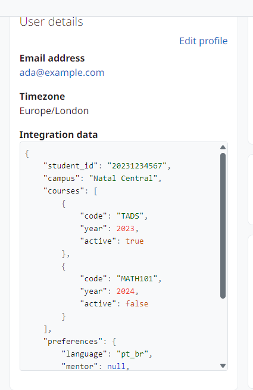

Usage
=====

Edit a document
---------------

On the profile edit page (and on the signup page, if the field is shown there), the JSON field opens the visual editor:

* **Tree:** expand objects and arrays, add, duplicate, move or remove items, and change the type of a value from the menu of each item.
* **Form:** edit only the values, keeping the structure.
* **Code:** edit the JSON as text with syntax highlighting, line numbers and buttons to format or compact it.
* **View:** read-only tree.

Every change is written to the form field. If the text is not valid JSON, a message under the editor shows the parser error, and the form refuses to save it until it is fixed.

A document that is not valid JSON opens in the code mode. Without JavaScript, or if the editor cannot start, the field is a plain monospaced textarea and the same server checks apply.

Display
-------

On the user profile, the document is shown pretty-printed in a scrollable code block, with keys, strings, numbers, booleans and ``null`` in different colours. The content is always escaped: HTML inside strings is shown as text.

   The JSON field on the user profile.

Web services and user upload
----------------------------

The field is available to web services and to the user upload (column ``profile_field_<shortname>``) like any other profile field. These paths do not run the form validation, so the field checks the value itself: a valid value is stored in canonical form, and an invalid one is ignored, keeping the stored value.
