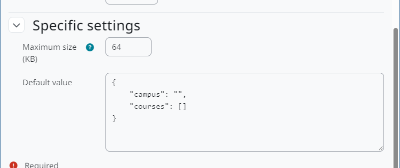

Configuração
============

Criar um campo JSON
-------------------

1. Acesse *Administração do site > Usuários > Contas > Campos de perfil do usuário*.
2. Em *Criar um novo campo de perfil*, escolha **JSON**.
3. Preencha as configurações comuns (nome curto, nome, descrição, obrigatório, bloqueado, único, cadastro, visibilidade).
4. Defina as configurações próprias do JSON e salve.

   Configurações próprias do JSON.

Configurações próprias do JSON
------------------------------

* **Tamanho máximo (KB):** maior documento que o usuário pode gravar no campo, de 1 a 1024 KB. Padrão: 64 KB.
* **Valor padrão:** documento JSON opcional usado para novos usuários. Precisa ser JSON válido e é guardado na forma canônica.

Como os valores são guardados
-----------------------------

Todo valor é conferido no servidor antes de ser gravado:

* precisa ser JSON válido (objetos, listas, strings, números, booleanos ou ``null``), com no máximo 64 níveis de aninhamento;
* precisa caber no tamanho máximo do campo.

Os valores aceitos são recodificados: formatados com quatro espaços, Unicode mantido como texto, e ``<``, ``>`` e ``&`` escapados dentro das strings (``\u003C``, ``\u003E``, ``\u0026``). Valor vazio significa "sem dado".

Privacidade
-----------

Os documentos são dados pessoais do usuário. Eles estão nos metadados de privacidade do plugin, são exportados com os dados do usuário e apagados quando os dados do usuário são apagados.
